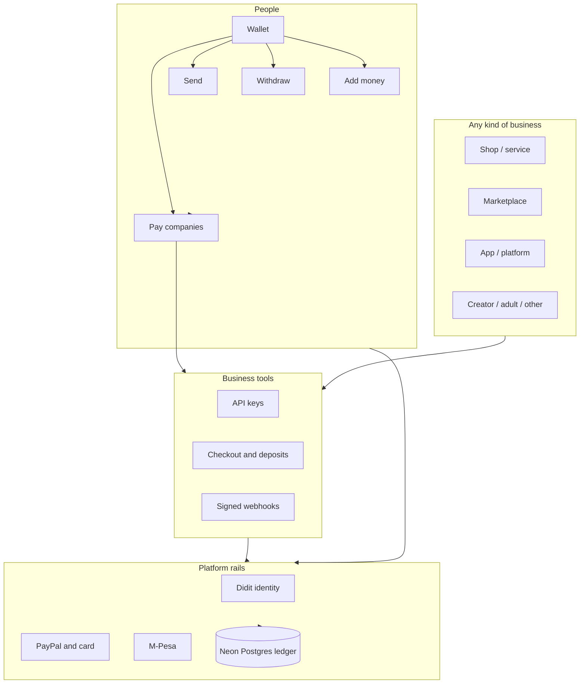

<p align="center">
  
</p>

<h1 align="center">Nora Shillings</h1>

<p align="center">
  <strong>Private payment infrastructure for every platform.</strong><br>
  One wallet. One rate. Every kind of business.
</p>

<p align="center">
  <em>100 NSH = 1 USD</em> — buy, pay, refund, and sell at the same fixed rate.
</p>

<p align="center">
  <a href="https://norashillings.benuru.com"></a>
  <a href="LICENSE"></a>
  <a href="package.json"></a>
  <a href="https://vercel.com"></a>
  
  
</p>

<p align="center">
  <a href="https://norashillings.benuru.com">Open the wallet</a> ·
  <a href="https://norashillings.benuru.com/docs">API docs</a> ·
  <a href="https://norashillings.benuru.com/product">Product</a> ·
  <a href="https://norashillings.benuru.com/developers">Developers</a> ·
  <a href="https://norashillings.benuru.com/about">About</a>
</p>

---

<p align="center">
  
</p>

## Who it is for

Nora Shillings is built for two sides of the same payment:

| You are… | What you get |
| --- | --- |
| **A person** | A free wallet: add money, send to friends, pay companies, withdraw when you verify |
| **A business** | Business tools: accept Nora on your site, API keys, checkout, deposits, webhooks |

You do **not** need to be a registered company. You give the company a name. That name is what checkout shows — not your personal name.

### Every kind of business is welcome

Card networks often block whole categories of commerce. Nora does **not** refuse a site because of its category.

A shop, a service, a marketplace, an app, a creator platform, or an adult site can take payment on its own page. Privacy is the point of the product: the buyer’s identity is not published, and settlement is not written to a public ledger where anyone can follow the amount, the time, and the path.

Nora is payment infrastructure. It is **not** a bank, an investment, or a savings product. Balances do not earn interest. The value stays fixed at the published rate.

## How it works

### 1. Open a wallet (free, no password)

Enter your email. Nora sends a one-time sign-in link. Opening it creates the account and signs you in. You can **add, send, pay, and withdraw** right away — identity verification is **not** required.

### 2. Hold Nora Shillings (NSH)

- **100 NSH = 1 US dollar**, always — to buy, to pay, to refund, and to sell
- One balance you can spend on any platform that connects the Nora payments API
- The same wallet works wherever Nora is accepted

### 3. Add money

Choose PayPal, card, or M-Pesa. Each method opens its own checkout. Successful payments credit the wallet once and send a receipt on screen and by email.

### 4. Move money

- **Send** — to another Nora account by email (free, instant)
- **Pay a company** — confirm at Nora checkout; the company name and amount are shown; if balance covers it, status becomes `paid`
- **Withdraw** — sell NSH back to USD and cash out to PayPal, card, or M-Pesa (withdrawing is free; no ID check required)

### 5. Take payments as a business

In **Business tools** you get:

- Sandbox keys to practice without real money
- Live keys when you are ready to take real payments
- Hosted checkout and deposit flows
- Signed webhooks (`payment.paid`, `payment.refunded`, and related events)
- Connected apps for platforms that embed Nora

The buyer pays exactly the amount shown. Nora does not add a fee on top for the buyer. The company pays **1% only when a payment is paid**. There is no monthly fee.

### What you can do

| Action | Available |
| --- | --- |
| Add money | Yes |
| Send to another wallet | Yes |
| Pay a company | Yes |
| Withdraw | Yes |
| Take live payments as a company | Yes |

Identity verification with Didit is optional and is not required to use the wallet or Business tools.

## Fees at a glance

| Item | Price |
| --- | --- |
| Opening an account | Free |
| Adding money | Free from Nora |
| Sending to another wallet | Free |
| Paying a company | Free for the buyer |
| Withdrawing | Free |
| Monthly fee | None |
| Company fee on a paid payment | 1% |

PayPal, your card issuer, or M-Pesa may charge their own fees under their own terms — those are not Nora fees.

## Architecture



| Layer | Role |
| --- | --- |
| Wallet | Personal Live balance at 100 NSH = 1 USD |
| Business tools | Accept NSH, issue keys, deliver signed webhooks |
| Identity | Didit session → verified name and country on the account |
| Ledger | Money movement recorded in Postgres under Nora’s controls |

## Stack

- **Runtime** — Node.js serverless on Vercel (`api/nsh.js` router)
- **Data** — Neon Postgres
- **Auth** — email magic links, optional TOTP / passkeys
- **KYC** — Didit hosted verification
- **Top-ups / payouts** — PayPal and PayHero (M-Pesa) when configured

## Quick start

```bash
git clone https://github.com/josephokero/nuru-shillings.git
cd nuru-shillings
cp .env.example .env   # fill in secrets locally — never commit .env
npm install
node scripts/migrate.mjs
node server.mjs        # http://localhost:8765
```

Required locally: `DATABASE_URL`, `NSH_ENC_KEY`, `APP_URL`.  
Optional: Didit, PayPal, PayHero, Resend, Bunny storage — see [`.env.example`](.env.example).

> **Security:** this repo ships with no API keys, database URLs, or webhook secrets. Keep production values in your host’s env store only.

## Repository layout

```
api/           Serverless handlers (wallet, KYC, pay, apps, security, admin)
scripts/       DB migrations and integration tests
*.html / *.js  Marketing site, wallet UI, business tools UI
docs/          Architecture art and brand assets for GitHub
img/           Founder and team photos
```

## Founder

<p align="center">
  
</p>

<p align="center">
  <strong>Joseph Nyarandi</strong> · Founder<br>
  Nora Shillings · founded June 2026<br>
  <a href="https://norashillings.benuru.com/about">About the team</a> ·
  <a href="mailto:norashillings@benuru.com">norashillings@benuru.com</a>
</p>

Director: **Emmanuel** — see the [About](https://norashillings.benuru.com/about) page.

## Contributing

Issues and thoughtful PRs are welcome. Do not open PRs that include `.env` files, keys, personal data, or production dumps.

## License

[MIT](LICENSE) © 2026 Joseph Nyarandi / Nora Shillings
