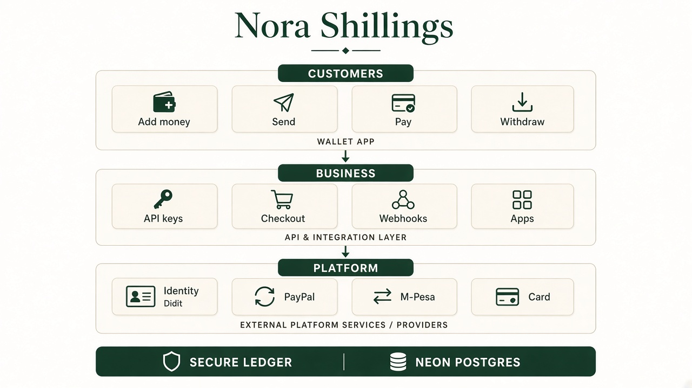
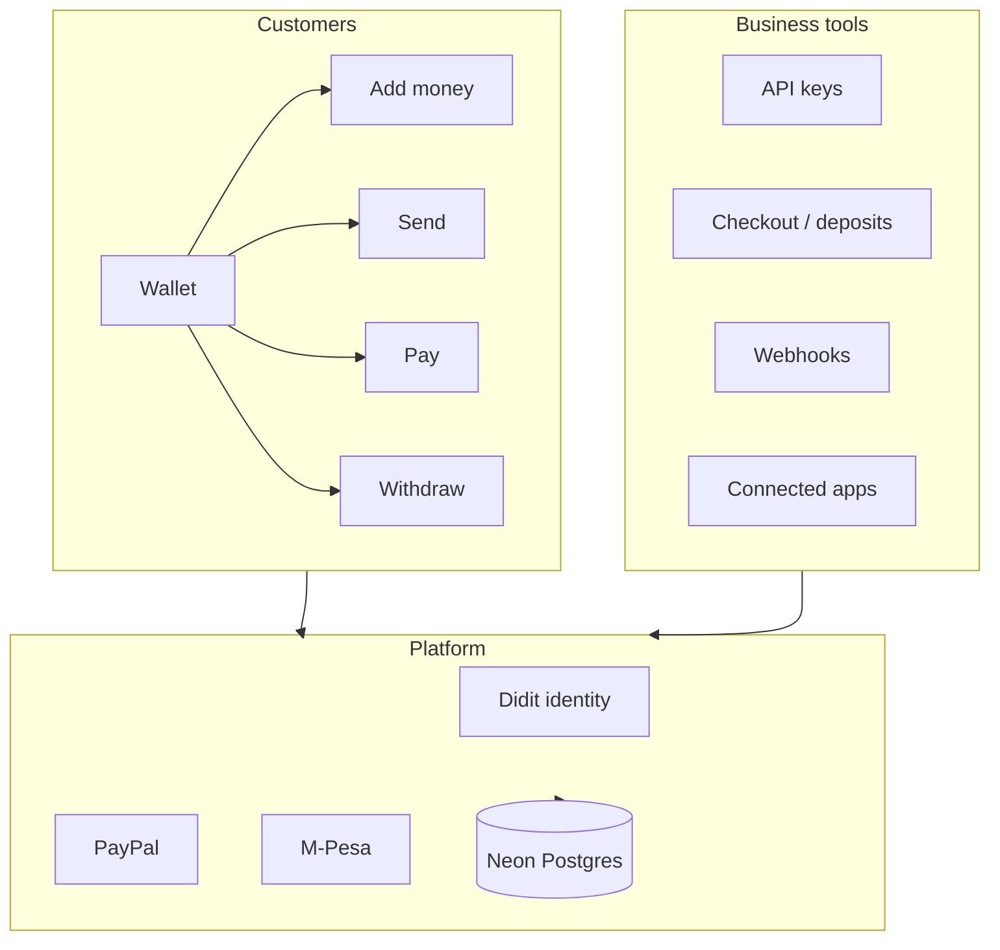

<p align="center">
  
</p>

<h1 align="center">Nora Shillings</h1>

<p align="center">
  <strong>Private payment infrastructure for every platform.</strong><br>
  A digital wallet and business toolkit — 100 NSH = 1 USD.
</p>

<p align="center">
  <a href="https://norashillings.benuru.com"></a>
  <a href="LICENSE"></a>
  <a href="package.json"></a>
  <a href="https://vercel.com"></a>
  
  
</p>

<p align="center">
  <a href="https://norashillings.benuru.com">Open the wallet</a> ·
  <a href="https://norashillings.benuru.com/docs">API docs</a> ·
  <a href="https://norashillings.benuru.com/product">Product</a> ·
  <a href="https://norashillings.benuru.com/about">About</a>
</p>

---

<p align="center">
  
</p>

## What it is

Nora Shillings is a live payments product:

- **Wallet** — add money, send, pay, and withdraw
- **Business tools** — API keys, hosted checkout, deposits, apps, and webhooks
- **Identity** — one free ID + selfie check (Didit) before withdrawals and live keys
- **Rails** — PayPal, card, and M-Pesa where configured

The buyer’s personal identity stays private. The company name is what checkout shows.

## Architecture



| Layer | Role |
| --- | --- |
| Wallet | Personal balances in Sandbox and Live |
| Business tools | Accept NSH, issue keys, deliver signed webhooks |
| Identity | Didit session → verified name & country on the account |
| Ledger | Append-only money movement in Postgres |

## Stack

- **Runtime** — Node.js serverless on Vercel (`api/nsh.js` router)
- **Data** — Neon Postgres
- **Auth** — email magic links, optional TOTP / passkeys
- **KYC** — Didit hosted verification
- **Payouts / top-ups** — PayPal and PayHero (M-Pesa) when env is set

## Quick start

```bash
git clone https://github.com/josephokero/nuru-shillings.git
cd nuru-shillings
cp .env.example .env   # fill in secrets locally — never commit .env
npm install
node scripts/migrate.mjs
node server.mjs        # http://localhost:8765
```

Required locally: `DATABASE_URL`, `NSH_ENC_KEY`, `APP_URL`.  
Optional: Didit, PayPal, PayHero, Resend, Bunny storage — see `.env.example`.

> **Security:** this repo ships with no API keys, database URLs, or webhook secrets. Keep production values in your host’s env store only.

## Repository layout

```
api/           Serverless handlers (wallet, KYC, pay, apps, security, admin)
scripts/       DB migrations and integration tests
*.html / *.js  Marketing site, wallet UI, business tools UI
docs/          Architecture art and brand assets for GitHub
```

## Founder

<p align="center">
  
</p>

<p align="center">
  <strong>Joseph Nyarandi</strong> · Founder<br>
  Nora Shillings · founded June 2026<br>
  <a href="https://norashillings.benuru.com/about">About the team</a> ·
  <a href="mailto:norashillings@benuru.com">norashillings@benuru.com</a>
</p>

Director: **Emmanuel** — see the [About](https://norashillings.benuru.com/about) page.

## Contributing

Issues and thoughtful PRs are welcome. Do not open PRs that include `.env` files, keys, personal data, or production dumps.

## License

[MIT](LICENSE) © 2026 Joseph Nyarandi / Nora Shillings
